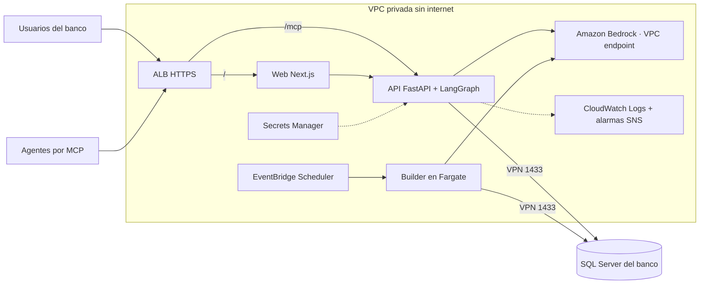

# Diseño: Despliegue en AWS

## Topología

## Entorno demo
La topología de arriba es el destino de qa y prod. El entorno `demo` (`envs/demo.tfvars`, `despliegue.sh up demo`) usa las mismas
imágenes con datos de prueba y al menor coste. Diagrama: [aws-demo-architecture.html](../../../docs/architecture/aws-demo-architecture.html).

| Pieza | qa / prod | demo |
|---|---|---|
| Red | Subredes privadas, VPC endpoints, sin internet | Tarea con IP pública y salida HTTPS; solo el endpoint de S3 (gateway); sin NAT |
| Entrada | ALB interno con HTTPS | ALB público por HTTP, limitado a la IP de quien despliega (`alb_ingress_cidrs`) |
| Cómputo | Fargate | Fargate Spot, 1 vCPU y 4 GB |
| SQL Server | El del banco, por Site-to-Site VPN | SQL Server 2022 Express en la tarea con las 5 bases de BancosSQL (ficticias) |
| LLM | Bedrock por VPC endpoint | Claude Sonnet 5.5 en Bedrock (Mantle) con el rol de la tarea; en pantalla también Haiku, NVIDIA NIM y Anthropic |
| Estado | BD `DiscoveryDataAgent` en el banco | En el SQL Server de la tarea: se pierde en cada reinicio |

## Infraestructura como código
`deploy/aws/terraform/`, un archivo por tema (red, VPN, seguridad, ALB, ECS, alarmas) y un `.tfvars` por entorno (`demo`, `qa`, `prod`).
Todo se opera con `bash deploy/aws/despliegue.sh <comando> <entorno>`: `bootstrap`, `plan`, `apply`, `deploy`, `rollback`, `logs`,
`secret`, `validate`, `destroy`.

## Servicios de AWS
ECS Fargate, Elastic Load Balancing (ALB), Amazon Bedrock, EventBridge Scheduler, ECR, Secrets Manager, CloudWatch, SNS, KMS y VPC
(endpoints y Site-to-Site VPN).

## Pruebas
`bash deploy/aws/despliegue.sh validate`: `terraform validate` y planes de prueba con el proveedor simulado (`terraform/tests/`).
