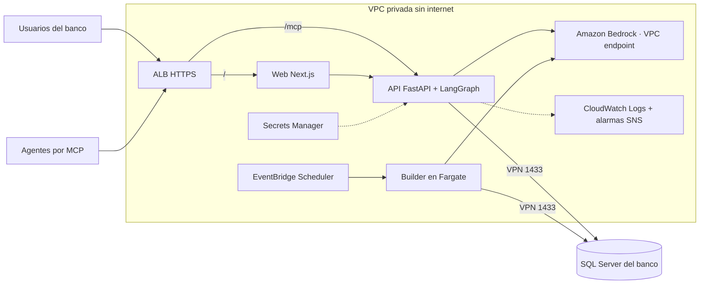

# Diseño: Despliegue en AWS

## Topología

## Infraestructura como código
`deploy/aws/terraform/`, un archivo por tema (red, VPN, seguridad, ALB, ECS, alarmas) y un `.tfvars` por entorno (`demo`, `qa`, `prod`).
Todo se opera con `bash deploy/aws/despliegue.sh <comando> <entorno>`: `bootstrap`, `plan`, `apply`, `deploy`, `rollback`, `logs`,
`secret`, `validate`, `destroy`.

## Servicios de AWS
ECS Fargate, Elastic Load Balancing (ALB), Amazon Bedrock, EventBridge Scheduler, ECR, Secrets Manager, CloudWatch, SNS, KMS y VPC
(endpoints y Site-to-Site VPN).

## Pruebas
`bash deploy/aws/despliegue.sh validate`: `terraform validate` y planes de prueba con el proveedor simulado (`terraform/tests/`).
