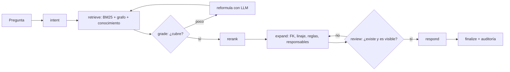

# Diseño: DiscoverFlow

## Visión general
Grafo de LangGraph con ciclos acotados, sin checkpointer persistente:

```
intent → retrieve ⇄ grade → rerank → expand ⇄ review → [compute] → respond → finalize
```

`compute` solo corre con las cifras agregadas activas. El orden de los candidatos es determinista; el LLM (rol `fast`) reformula la
búsqueda, orienta cuando no hay candidatos y redacta la respuesta.



## Componentes
| Componente | Ubicación | Responsabilidad |
|---|---|---|
| Flujo | `src/discovery_data_agent/flows/discover.py` | Nodos y aristas del grafo, streaming de pasos |
| Motor determinista | `src/discovery_data_agent/discovery/engine.py`, `deterministic.py`, `expansion.py` | Intención sin LLM, cobertura, calificativos, literales, confianza |
| Asistente | `src/discovery_data_agent/discovery/assistant.py` | Respuestas fijas sobre el asistente y cortesía |
| Nodos con LLM | `src/discovery_data_agent/llm/nodes.py` | `LlmQueryExpander`, `LlmGuide`, narrativa |
| Grafo del patrimonio | `src/discovery_data_agent/graph/estate.py` | Entidades, copias canónicas, `find_join_path` |
| Identidad | `src/discovery_data_agent/identity/` | `visible_ids` a partir del login SQL |
| Herramientas | `src/discovery_data_agent/application/discovery.py` | Capa compartida por la API y el MCP |

## Modelo de datos
Sobre `AnswerEnvelope.discovery`: `candidates[]` (rank, kind, asset_key, locations, description, description_source, business_rules,
owners, lineage, evidence, confidence), `alternatives[]`, `related[]`, `knowledge_gap`, `clarification`, `assumptions`.

## Manejo de errores
- Sin modelo, con el circuito abierto o sin tokens: modo determinista.
- Texto generado con objetos fuera de la lista: se descarta y se usa la plantilla.
- Fallo de auditoría: la respuesta no sale (fail-closed).

## Estrategia de pruebas
- Unitarias y de flujo: `tests/test_graph_rag.py`, `tests/test_chat_conversacional.py`, `tests/test_application_discovery.py`.
- Evaluación: `tests/fixtures/bancos/eval/*.yaml` y `tests/fixtures/vbank/eval/discovery.yaml` contra su `baseline.yaml`.
- Compuerta: `discovery-data-agent eval gate` en `.github/workflows/calidad.yml`.
