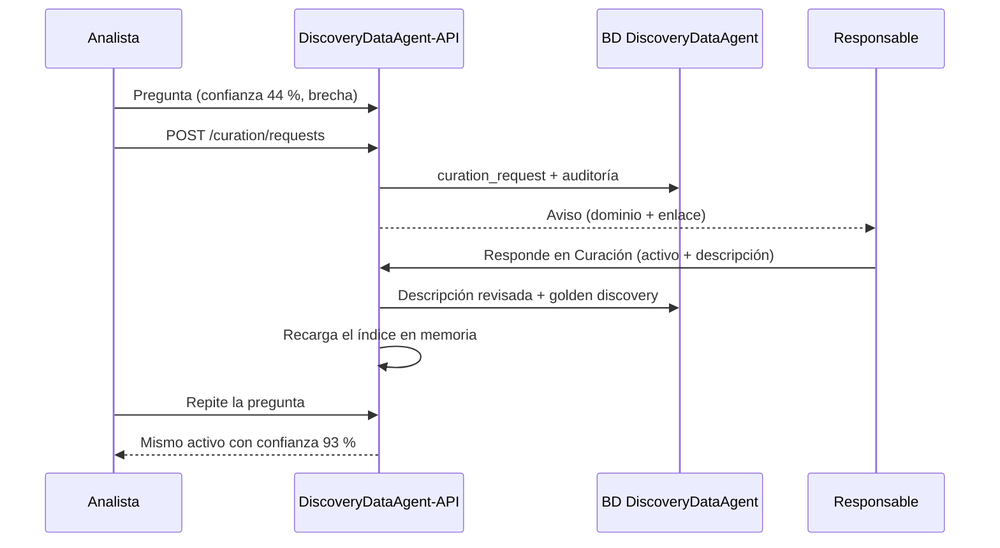

# Diseño: Curación del conocimiento

## Visión general

## Componentes
| Componente | Ubicación |
|---|---|
| Plantilla anónima y regla de votos | `src/discovery_data_agent/curation.py` (`question_template`, `resolve_golden`) |
| Literales | `src/discovery_data_agent/memory/text.py` (`strip_literals`) |
| Repositorio | `src/discovery_data_agent/storage/curation_repository.py` |
| Migración | `db/discovery_data_agent/002_curacion.sql` |
| Rutas | `api/discovery_data_agent_api/curation.py` (`/curation/*`, `/admin/stewards`) |
| Vistas | `web/` (Curación, Mis solicitudes, Responsables, Historial) |

## Datos
Esquemas `curation` (responsables, solicitudes, votos) y `golden` (pares plantilla → activo, original solo sin literales) en tablas
temporales para el historial.

## Pruebas
`api/tests/test_marked_literals.py` (100 literales en 10 formas), pruebas de curación de la API y de `curation.py`.
